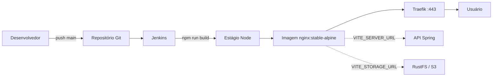

# PW45S — Cliente React (deploy)

Aplicação **React 19** + **TypeScript** + **Vite** servida por **Nginx** em container Docker. O build de produção embute as URLs da API e do armazenamento de arquivos; o tráfego público passa pelo **Traefik** (HTTPS). O deploy automatizado é feito pelo **Jenkins**, no mesmo servidor onde rodam Traefik, PostgreSQL (API) e demais serviços de [`../server-config/`](../server-config/).

O código-fonte é o mesmo da [aplicação cliente da aula07](../../aula07/client/README.md) (utilizada também nas aulas 08 e 09): cadastros de categorias e produtos, login com usuário e senha ou Google, upload e exibição da imagem do produto e tema claro/escuro. Nesta aula foram adicionados os arquivos de deploy e as URLs passaram a ser lidas de **variáveis de ambiente**.

## Visão geral do fluxo



1. Push na branch `main` dispara o pipeline (webhook ou polling).
2. **Docker build**: o estágio Node compila o Vite; o estágio Nginx serve os arquivos estáticos em `/usr/share/nginx/html`.
3. **Docker Compose** sobe o container `pw45s-client` na rede `web`.
4. O **Traefik** roteia `https://<dominio>` para a porta 80 do container.

A API (`server/`) é publicada separadamente; o cliente consome `VITE_SERVER_URL`, configurada no momento do build.

## Arquivos envolvidos no deploy

| Arquivo | Função |
|---------|--------|
| [`Dockerfile`](Dockerfile) | Build multi-stage: Node 22 executa `npm ci` e `npm run build`; Nginx Alpine serve `dist/` |
| [`nginx.conf`](nginx.conf) | Configuração do Nginx: devolve o `index.html` para as rotas do React Router |
| [`.dockerignore`](.dockerignore) | Evita copiar `node_modules`, `dist` e `.git` para a imagem |
| [`docker-compose.yml`](docker-compose.yml) | Serviço `pw45s-client` (build da imagem), labels Traefik e rede `web` |
| [`Jenkinsfile`](Jenkinsfile) | `docker compose up -d --build` |
| [`.env.production`](.env.production) | Variáveis `VITE_*` usadas no build de produção |
| [`.env.development`](.env.development) | Variáveis `VITE_*` usadas em desenvolvimento local (`npm run dev`) |
| [`src/vite-env.d.ts`](src/vite-env.d.ts) | Tipos das variáveis `VITE_*` (TypeScript) |
| [`src/lib/axios.ts`](src/lib/axios.ts) | Cliente HTTP com `import.meta.env.VITE_SERVER_URL` |

## Dockerfile

Build em duas etapas:

1. **`node:22-alpine`**: `npm ci` (instala exatamente as versões do `package-lock.json`), copia o projeto e executa `npm run build` (saída em `dist/`).
2. **`nginx:stable-alpine`**: copia o `nginx.conf` e a pasta `dist/` para `/usr/share/nginx/html` e expõe a porta **80**.

> As variáveis `VITE_*` são resolvidas **no build**. Para alterar as URLs em produção, é necessário **rebuildar** a imagem com o `.env.production` correto (o pipeline Jenkins faz isso a cada deploy).

### Rotas do React Router no Nginx

A aplicação utiliza o `BrowserRouter`, então rotas como `/products` não existem como arquivos na pasta `dist/`. Sem configuração, ao recarregar a página (F5) ou acessar um link direto, o Nginx retornaria **404**. O [`nginx.conf`](nginx.conf) resolve isso respondendo com o `index.html` sempre que o arquivo não existir:

```nginx
location / {
    try_files $uri $uri/ /index.html;
}
```

## Variáveis de ambiente (Vite)

| Variável | `.env.development` | `.env.production` | Uso |
|----------|--------------------|-------------------|-----|
| `VITE_SERVER_URL` | `http://localhost:8080` | `https://api.viniciuspegorini.com.br` | URL base da API (`src/lib/axios.ts`) |
| `VITE_STORAGE_URL` | `http://localhost:9000/pw45s` | `https://rustfs.viniciuspegorini.com.br/pw45s` | URL pública do bucket com as imagens dos produtos |
| `VITE_GOOGLE_CLIENT_ID` | Client ID do curso | Client ID do curso | Login com o Google (`src/main.tsx`); deve ser o mesmo `GOOGLE_CLIENT_ID` da API |

Uso no código:

```typescript
// src/lib/axios.ts
baseURL: import.meta.env.VITE_SERVER_URL

// src/components/product-card/index.tsx e src/pages/product-form/index.tsx
src={`${import.meta.env.VITE_STORAGE_URL}/${product.imageName}`}
```

Antes do deploy, ajuste o `.env.production` para os subdomínios reais da API e do RustFS (os mesmos hosts configurados no Traefik). No Google Cloud Console, adicione o domínio do cliente em **Authorized JavaScript origins** do Client ID.

## docker-compose.yml

| Configuração | Valor |
|--------------|-------|
| Imagem / build | `pw45s-client` (build local via `Dockerfile`) |
| Container | `pw45s-client` |
| Porta host | `8100:80` (acesso direto opcional) |
| Rede | `web` (externa, compartilhada com Traefik) |

### Labels Traefik

```yaml
traefik.http.routers.pw45s-client.rule=Host(`viniciuspegorini.com.br`)
traefik.http.routers.pw45s-client.entrypoints=websecure
traefik.http.routers.pw45s-client.tls.certresolver=letsencrypt
traefik.http.services.pw45s-client.loadbalancer.server.port=80
```

Substitua o `Host` pelo domínio raiz do frontend. O Traefik em `server-config` emite o certificado Let's Encrypt e redireciona HTTP → HTTPS.

## Pipeline Jenkins

Pré-requisitos (no servidor):

1. Stack [`../server-config/`](../server-config/) em execução (Traefik, Jenkins, etc.).
2. Rede Docker externa: `docker network create --driver=bridge --attachable web`

Criar job **Client** no Jenkins:

| Campo | Valor |
|-------|--------|
| Tipo | Pipeline |
| SCM | Git |
| Repository URL | `https://github.com/viniciuspegorini/pw45s` |
| Branch | `*/main` |
| **Script Path** | `aula11/client/Jenkinsfile` (o Jenkinsfile não está na raiz do repositório) |

O [`Jenkinsfile`](Jenkinsfile) possui um único estágio, **Docker Compose UP**, que executa `docker compose up -d --build` dentro da pasta `aula11/client` (bloco `dir('aula11/client')`): gera a imagem `pw45s-client` e cria (ou atualiza) o container.

Como o repositório contém todas as aulas, qualquer *push* dispararia o job pelo *webhook*. Para executar o deploy somente quando o cliente for alterado, em **SCM → Additional Behaviours → Polling ignores commits in certain paths**, informe em *Included Regions*:

```text
aula11/client/.*
```

O Jenkins utiliza o Docker do host (socket montado no container Jenkins da infraestrutura).

### Deploy manual

Na pasta `aula11/client/`:

```bash
# conferir .env.production
docker compose up -d --build
```

Acesse via Traefik: `https://<seu-dominio>` ou diretamente: `http://<IP>:8100`.

## Relação com API, PostgreSQL e Traefik

| Serviço | Papel no cliente |
|---------|------------------|
| **Traefik** | Termina TLS e roteia o domínio do frontend para o container Nginx |
| **API Spring** | Backend REST; URL definida em `VITE_SERVER_URL` |
| **RustFS (S3)** | Imagens dos produtos, lidas diretamente pelo navegador em `VITE_STORAGE_URL` |
| **PostgreSQL** | Usado apenas pela API; o cliente não conecta ao banco |
| **Jenkins** | Automatiza o build e a publicação da imagem `pw45s-client` |

Ordem sugerida no primeiro deploy:

1. Infraestrutura (`server-config`)
2. Banco `pw45s` + deploy da **API** (`server/`)
3. Ajustar `.env.production` com as URLs públicas da API e do RustFS
4. Deploy do **cliente** (este projeto)

## Desenvolvimento local

Com a API em execução (ver [`../server/README.md`](../server/README.md)):

```bash
npm install
npm run dev
```

O Vite utiliza o `.env.development` e sobe em `http://localhost:5173` (porta padrão).

## Checklist pós-deploy

- [ ] `.env.production` com `VITE_SERVER_URL` e `VITE_STORAGE_URL` em HTTPS
- [ ] Imagem `pw45s-client` gerada novamente após qualquer mudança de URL
- [ ] Container `pw45s-client` na rede `web`
- [ ] DNS do domínio raiz apontando para o Droplet (Cloudflare)
- [ ] `https://<dominio>` carrega o SPA, as chamadas vão para a API e as imagens dos produtos são exibidas
- [ ] Recarregar uma rota interna (ex.: `/products`) não retorna 404

## Referências

- [Vite — Env variables](https://vitejs.dev/guide/env-and-mode.html)
- [React — Documentação](https://react.dev/)
- [Nginx — Docker image](https://hub.docker.com/_/nginx)
- [Traefik — HTTP routers](https://doc.traefik.io/traefik/routing/routers/)
- [Jenkins — Pipeline](https://www.jenkins.io/doc/book/pipeline/)
- API e banco: [`../server/README.md`](../server/README.md)
- Infraestrutura: [`../server-config/Readme.MD`](../server-config/Readme.MD)
