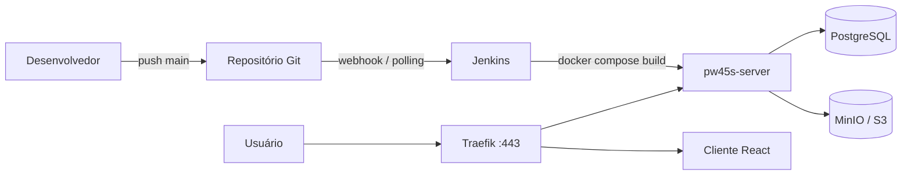

# PW45S — API Spring Boot (deploy)

API REST em **Spring Boot 4.0** / **Java 25** que persiste dados no **PostgreSQL**, armazena arquivos em um serviço de **armazenamento de objetos compatível com o Amazon S3** (RustFS em desenvolvimento, MinIO no servidor de produção) e é publicada em produção via **Jenkins**, atrás do **Traefik** (HTTPS e roteamento por subdomínio).

O código-fonte é o mesmo da [API da aula09](../../aula09/server/README.MD): autenticação JWT e Google, CRUD de categorias e produtos, upload de imagens com o AWS SDK (S3) e observabilidade com OpenTelemetry. Nesta aula foram adicionados os arquivos de deploy e a configuração por **variáveis de ambiente**.

A infraestrutura base (Traefik, Jenkins, PostgreSQL, MinIO, pgAdmin) é provisionada na pasta [`../server-config/`](../server-config/). Este documento descreve o deploy **desta aplicação** e como ela se integra a esses serviços.

## Visão geral do fluxo



1. O código é versionado no Git, neste repositório ([pw45s](https://github.com/viniciuspegorini/pw45s)), na pasta `aula11/server`.
2. O **Jenkins** faz o checkout do repositório e executa o `aula11/server/Jenkinsfile`: `docker compose up -d --build` dentro da pasta `aula11/server`.
3. O **Dockerfile** compila o JAR com Maven e gera a imagem de runtime.
4. O container `pw45s-server` entra nas redes Docker `web` e `database`.
5. O **Traefik** descobre o serviço pelos labels e expõe `https://api.<seu-dominio>`.

## Arquivos envolvidos no deploy

| Arquivo | Função |
|---------|--------|
| [`Dockerfile`](Dockerfile) | Build multi-stage: compila com `eclipse-temurin:25-jdk-alpine` e executa o JAR com `eclipse-temurin:25-jre-alpine` |
| [`docker-compose.yml`](docker-compose.yml) | Produção: serviço `api`, variáveis de ambiente e labels do Traefik |
| [`Jenkinsfile`](Jenkinsfile) | Pipeline CI/CD: credenciais do Jenkins + `docker compose up -d --build` na pasta `aula11/server` |
| [`.env-example`](.env-example) | Modelo de variáveis para executar o `docker-compose.yml` sem o Jenkins |
| [`compose.dev.yaml`](compose.dev.yaml) | Desenvolvimento local: PostgreSQL, RustFS e Grafana LGTM |
| [`src/main/resources/application.yaml`](src/main/resources/application.yaml) | Perfis Spring (`dev`, `prod`, `test`), datasource, storage e OpenTelemetry |
| [`pom.xml`](pom.xml) | Artefato Maven `server-0.1.jar` (copiado no estágio final do Docker) |

## Perfis do Spring

| Perfil | Banco de dados | Migrações (Flyway) | Uso |
|--------|----------------|--------------------|-----|
| `dev` (padrão) | PostgreSQL em `localhost:5432` | `db/dev`: tabelas + dados de exemplo | Desenvolvimento local |
| `prod` | PostgreSQL informado em `DATABASE_URL` | `db/prod`: tabelas + permissões (`ROLE_USER`, `ROLE_ADMIN`) | Container em produção |
| `test` | H2 em memória | `db/test`: tabelas | Testes automatizados (`./mvnw test`) |

O perfil é escolhido pela variável `SPRING_PROFILES_ACTIVE`.

## Executando em desenvolvimento

O arquivo [`compose.dev.yaml`](compose.dev.yaml) sobe os serviços utilizados pela API no perfil `dev`:

| Serviço | Porta | Acesso |
|---------|-------|--------|
| PostgreSQL 17 | `5432` | banco `pw45s`, usuário/senha `postgres` |
| RustFS (S3) | `9000` (API) / `9001` (console) | usuário/senha `rustfsadmin` |
| Grafana LGTM | `3000` (Grafana) / `4317` e `4318` (OTLP) | [http://localhost:3000](http://localhost:3000) |

```bash
docker compose -f compose.dev.yaml up -d
./mvnw spring-boot:run
```

> Se a porta 5432 já estiver em uso por outro PostgreSQL, utilize outra porta no host:
> `POSTGRES_PORT=5433 docker compose -f compose.dev.yaml up -d` e execute a API com `DATABASE_URL=jdbc:postgresql://localhost:5433/pw45s`.

O bucket (`pw45s`) é criado pela API no primeiro upload, com permissão de leitura pública dos objetos. Assim, a aplicação cliente exibe as imagens diretamente pela URL `http://localhost:9000/pw45s/<arquivo>`.

Os testes automatizados utilizam o perfil `test` (H2) e não dependem de nenhum serviço:

```bash
./mvnw test
```

## Dockerfile

O build ocorre em duas etapas:

1. **Build** (`eclipse-temurin:25-jdk-alpine`): copia `mvnw`, `.mvn`, `pom.xml` e `src/`, remove o `\r` do `mvnw` (arquivo editado no Windows) e executa `mvnw package -DskipTests`.
2. **Delivery** (`eclipse-temurin:25-jre-alpine`): copia `target/server-0.1.jar` para `/app/server.jar` e inicia com `java -jar server.jar`. A imagem final contém apenas o JRE, sem o Maven e o código-fonte.

## docker-compose.yml

O serviço `api` publica a aplicação e conecta-se à infraestrutura já em execução:

| Configuração | Valor |
|--------------|-------|
| Imagem / build | `pw45s-server` (build local via `Dockerfile`) |
| Container | `pw45s-server` |
| Porta | `8080:8080` |
| Redes | `web` (externa, Traefik) e `database` (PostgreSQL) |

### Labels Traefik

O Traefik (em `server-config`) roteia tráfego HTTPS com base nos labels:

```yaml
traefik.http.routers.pw45s-server.rule=Host(`api.viniciuspegorini.com.br`)
traefik.http.routers.pw45s-server.entrypoints=websecure
traefik.http.routers.pw45s-server.tls.certresolver=letsencrypt
traefik.http.services.pw45s-server.loadbalancer.server.port=8080
```

Substitua o host pelo subdomínio da API no seu domínio. O registro DNS tipo **A** deve apontar para o IP do Droplet; o certificado TLS é emitido pelo Let's Encrypt (desafio DNS via Cloudflare, configurado no Traefik).

## PostgreSQL

O perfil **`prod`** em `application.yaml` usa:

- URL: `${DATABASE_URL}` (JDBC)
- Usuário/senha: `${DATABASE_USERNAME}` / `${DATABASE_PASSWORD}`
- Migrações: Flyway em `classpath:/db/prod`, que cria as tabelas e as permissões `ROLE_USER` e `ROLE_ADMIN` (atribuídas no cadastro de usuários)

O módulo `flyway-database-postgresql` é necessário a partir do Flyway 10 para migrar bancos PostgreSQL.

### Criar o banco (primeira vez)

Com o stack `server-config` em execução:

```bash
docker exec -it postgresql psql -U postgres -c "CREATE DATABASE pw45s;"
```

### Conexão na mesma máquina Docker

Quando API e PostgreSQL estão no mesmo host, use o **nome do container** na rede `database`:

```properties
DATABASE_URL=jdbc:postgresql://postgresql:5432/pw45s
```

## Variáveis de ambiente

Todas as configurações que mudam entre os ambientes são lidas de variáveis de ambiente. Quando uma variável não é informada, é utilizado o valor padrão definido no `application.yaml` (valores de desenvolvimento).

| Variável | Padrão | Descrição |
|----------|--------|-----------|
| `SERVER_PORT` | `8080` | Porta HTTP da API |
| `SPRING_PROFILES_ACTIVE` | `dev` | Perfil Spring (`dev`, `prod`) |
| `DATABASE_URL` | `jdbc:postgresql://localhost:5432/pw45s` | JDBC do PostgreSQL |
| `DATABASE_USERNAME` / `DATABASE_PASSWORD` | `postgres` / `postgres` | Credenciais do banco |
| `GOOGLE_CLIENT_ID` | Client ID do curso | OAuth Google: deve ser o mesmo Client ID da aplicação cliente |
| `STORAGE_ENDPOINT` | `http://127.0.0.1:9000` | Endpoint do serviço S3 (RustFS, MinIO...) |
| `STORAGE_PORT` | `9000` | Porta do serviço S3 (`443` quando HTTPS) |
| `STORAGE_ACCESS_KEY` / `STORAGE_SECRET_KEY` | `rustfsadmin` / `rustfsadmin` | Credenciais do serviço S3 |
| `STORAGE_SECURE` | `false` | `true` para usar HTTPS |
| `STORAGE_BUCKET_NAME` | `pw45s` | Bucket em que as imagens dos produtos são armazenadas |
| `OTLP_ENABLED` | `true` | Envio de métricas, traces e logs via OpenTelemetry |
| `OTLP_ENDPOINT` | `http://localhost:4318` | Endereço do coletor OTLP (Grafana LGTM) |

No `docker-compose.yml`, `OTLP_ENABLED` é `false` por padrão, pois o servidor de produção não possui um coletor OTLP (Grafana LGTM). Para enviar os dados de observabilidade, informe `OTLP_ENABLED=true` e o `OTLP_ENDPOINT` do coletor.

### Produção (Jenkins + `docker-compose.yml`)

O [`Jenkinsfile`](Jenkinsfile) define o ambiente do pipeline:

| Variável | Origem |
|----------|--------|
| `SPRING_PROFILES_ACTIVE` | `prod` |
| `DATABASE_URL` | `jdbc:postgresql://postgresql:5432/pw45s` (rede `database`) |
| `DATABASE_USERNAME`, `DATABASE_PASSWORD` | Credencial Jenkins `postgres_id` |
| `GOOGLE_CLIENT_ID` | Credencial `pw45s_google_client_id` (campo *Username*) |
| `STORAGE_ACCESS_KEY`, `STORAGE_SECRET_KEY` | Credencial `pw45s_storage_id` (usuário e senha do MinIO) |
| `STORAGE_ENDPOINT` | `https://minio.<dominio>` (porta `443`, `STORAGE_SECURE=true`) |
| `OTLP_ENABLED` | `false` |

Credenciais no Jenkins: **Manage Jenkins → Credentials → System → Global credentials** (detalhes em [`../server-config/Readme.MD`](../server-config/Readme.MD)).

## Pipeline Jenkins

1. Subir a infraestrutura em `server-config` (Traefik, Jenkins, PostgreSQL, MinIO).
2. Configurar credenciais globais (`postgres_id`, `pw45s_google_client_id`, `pw45s_storage_id`).
3. Criar item **Pipeline** (*New Item*) apontando para este repositório:
   - Definition: *Pipeline script from SCM*
   - SCM: *Git*, Repository URL: `https://github.com/viniciuspegorini/pw45s`
   - Branch: `*/main`
   - **Script Path: `aula11/server/Jenkinsfile`** (o Jenkinsfile não está na raiz do repositório)
   - Trigger opcional: *GitHub hook trigger for GITScm polling*
4. Executar o job **Server**: estágio único `docker compose up -d --build`, executado dentro da pasta `aula11/server` (bloco `dir('aula11/server')` do Jenkinsfile).

Como o repositório contém todas as aulas, qualquer *push* dispararia o job pelo *webhook*. Para executar o deploy somente quando a API for alterada, em **SCM → Additional Behaviours → Polling ignores commits in certain paths**, informe em *Included Regions*:

```text
aula11/server/.*
```

O Jenkins roda em container com acesso ao socket Docker (`/var/run/docker.sock`), permitindo build e subida dos containers no host.

### Deploy manual (sem Jenkins)

Na pasta `aula11/server/`, com a rede `web` criada e o PostgreSQL acessível:

```bash
cp .env-example .env
# editar .env
docker compose up -d --build
```

## Integração com o armazenamento (S3) e o Traefik

- **Armazenamento**: a API utiliza o cliente S3 do AWS SDK (`software.amazon.awssdk:s3`) com *path-style* (`https://host/bucket/objeto`), funcionando com qualquer serviço compatível com o S3. Em produção, `STORAGE_ENDPOINT` usa HTTPS no subdomínio do MinIO exposto pelo Traefik (`minio.<dominio>`). Bucket padrão: `pw45s`.
- **Traefik**: apenas encaminha HTTPS; não altera variáveis da API. Garanta Traefik **v3.6+** se o Docker Engine for 29+ (ver [`../server-config/traefik/README.md`](../server-config/traefik/README.md)).

## Checklist pós-deploy

- [ ] Container `pw45s-server` em execução (`docker ps`)
- [ ] Banco `pw45s` criado e Flyway aplicado (`docker logs pw45s-server`)
- [ ] `https://api.<dominio>/actuator/health` responde `{"status":"UP"}` (certificado válido no Traefik)
- [ ] Cadastro de usuário e login funcionando
- [ ] Upload de imagem de produto funcionando (bucket `pw45s` criado no MinIO)

## Referências

- [Spring Boot — Documentação](https://docs.spring.io/spring-boot/)
- [Spring Boot — Externalized Configuration](https://docs.spring.io/spring-boot/reference/features/external-config.html)
- [Spring Data JPA](https://docs.spring.io/spring-data/jpa/reference/)
- [Flyway](https://documentation.red-gate.com/flyway)
- [AWS SDK for Java 2.x — S3](https://docs.aws.amazon.com/sdk-for-java/latest/developer-guide/examples-s3.html)
- [Docker — Multi-stage builds](https://docs.docker.com/build/building/multi-stage/)
- [Traefik — Docker provider](https://doc.traefik.io/traefik/providers/docker/)
- [Jenkins — Pipeline](https://www.jenkins.io/doc/book/pipeline/)
- Infraestrutura do curso: [`../server-config/Readme.MD`](../server-config/Readme.MD)
